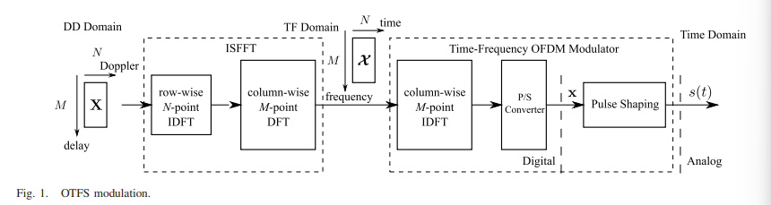
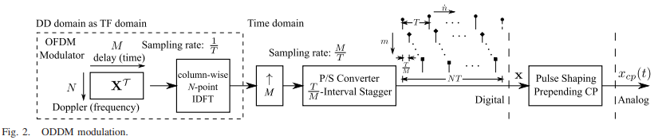
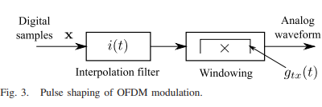
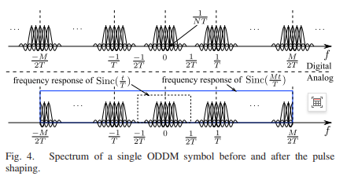
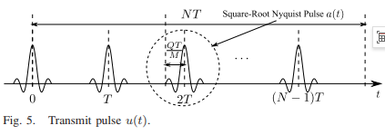
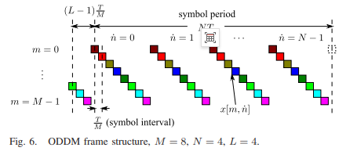
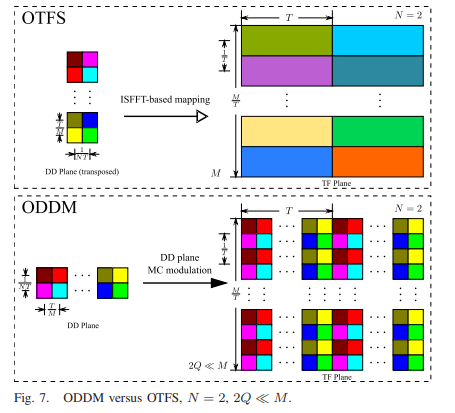
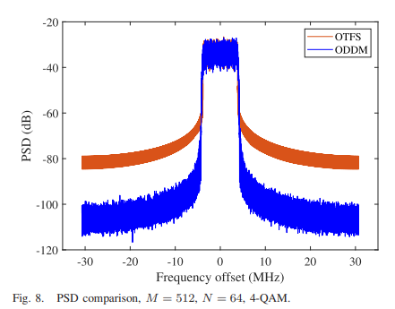
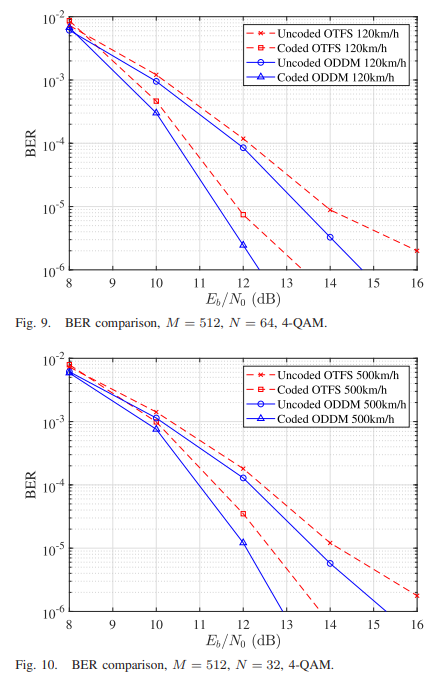

# Orthogonal Time-Delay - Doppler Multiplexing with Differential Modulation (ODDM): A New Approach for Next-Generation High Mobility Communication

I. Orthogonal Delay-Doppler Division Multiplexing (ODDM) - Time-Frequency Spatial Orthogonality
II. Abstract Influenced by the orthogonal time-frequency spatial (OTFS) modulation, this paper investigates multicarrier (MC) modulation in the design of delay-Doppler (DD) plane, achieving coupling between the modulated signal and a dual selective channel with DD resolution. The core challenge in designing DD plane MC modulation lies in whether there exists an implementable, orthogonal pulse with respect to the fine resolution of the DD plane.
To this end, this paper first points out that feasible DD plane MC modulation essentially belongs to an interleaved multiplicity (SMT) modulation category. Subsequently, analogous to orthogonal frequency division multiplexing (OFDM), it proposes orthogonal time-delay-Doppler division multiplexing (ODDM) modulation and designs corresponding transmission pulses. Moreover, this paper demonstrates that the proposed transmission pulses are orthogonal with respect to the DD plane resolution, i.e., there exist implementable DD plane orthogonal pulses.
The orthogonality of this specific pulse greatly simplifies the derivation process of the DD domain channel input-output relationship for ODDM, resulting in a channel matrix with a beautiful block cyclic structure. Simulation results show that through realizing perfect coupling between the modulated signal and the DD channel, ODDM achieves better performance in out-of-band radiation (OOBE) and bit error rate (BER) compared to OTFS.
III. Introduction One of the important application scenarios for next-generation ultra-5G/6G cellular systems is high mobility communication. For example, Japan plans to open the central Shinkansen superconducting maglev train from Tokyo to Nagoya in 2027, reaching a speed of 500 kilometers per hour. How to achieve reliable communication under such high mobility conditions is a highly challenging topic.
On the other hand, the congestion in the microwave band has driven cellular systems to migrate towards millimeter-wave bands, which possess vast spectrum gaps. The combination of high carrier frequency and high mobility leads to severe fast time-varying characteristics of channels. It is evident that time-varying characteristics are a channel characteristic that needs to be considered in the design of next-generation waveforms, while the channel model based on deterministic paths in the delay-Doppler (DD) domain may be more insightful than the traditional statistical channel model in the time-frequency (TF) domain.
As is well known, current fourth-generation (4G) and fifth-generation (5G) cellular systems employing orthogonal frequency division multiplexing (OFDM) modulation may not work properly in future high mobility environments. In addition to path gain, each path introduces Doppler shift and propagation delay, respectively corresponding to the time-domain and frequency-domain dispersion of the channel, making the channel have both time-selective and frequency-selective characteristics in this environment. After passing through a dual selective channel, the received signal waveform is the superposition of multiple OFDM waveform replicas with different gains, delays, and Doppler shifts.
Although OFDM can mitigate inter-symbol interference (ISI) caused by delay by adding cyclic prefix (CP) to each OFDM symbol, the remaining inter-carrier interference (ICI) caused by Doppler shift will lead to significant performance degradation. Typically, the length of an OFDM frame needs to satisfy the condition that the time-varying multipath channel can be approximated as time-invariant, i.e., the frame length should be within the coherence time of the channel (at this time the channel is quasi-time-invariant, and the Doppler-induced channel variations can be ignored), so that the receiver can demodulate the OFDM signal through discrete Fourier transform (DFT) and subsequent subcarrier level single tap frequency domain equalizer. Therefore, traditional OFDM can obtain frequency diversity gain through subcarrier coding, but it cannot utilize time diversity gain.
In contrast to time-frequency (TF) plane modulation in OFDM, the recent proposal of Orthogonal Time-Frequency Spatial (OTFS) modulation proposes that information is carried by symbols on the DD plane. OTFS views the channel's spreading effect as potential temporal and frequency diversity rather than harmful interference. Therefore, in high mobility environments, its performance surpasses traditional OFDM. The core advantage of OTFS lies in the natural physical representation of dual selective channels in the DD domain (i.e., the impulse response of the DD channel), where each path appears as a constant-time-delayed channel tap in the DD plane, positioned by the time delay and Doppler shift of the path.
During the steady state of the dual selective channel (when this characterization holds true), the received OTFS signal in the DD domain can be considered as a two-dimensional convolution between the conveyed information symbol and the effective DD domain channel, which takes into account the combined effects of ideal transmit pulses, DD channel, and ideal receive pulses. Thus, OTFS can utilize both frequency and time diversity to achieve reliable communication.
It is important to note that the DD plane is essentially another time-frequency plane, with its fine grid corresponding to time delay and Doppler resolution. OTFS attempts to couple the transmitted signal with the channel, i.e., matching the resolution of the signal modulation with the DD plane channel resolution. Since the DD plane divides according to specific time (delay) and frequency (Doppler) resolution, modulation following the DD plane resolution naturally becomes subcarrier-interval equal to Doppler resolution multicarrier modulation.
Considering that information symbols are placed individually on the DD plane, it is clear that DD plane multicarrier modulation requires an orthogonal pulse relative to the DD plane resolution (hereafter referred to as DD plane orthogonal pulse). According to the Heisenberg uncertainty principle, pulses confined within a single fine grid on the DD plane (ideal DD plane orthogonal pulse) do not exist, which poses difficulties for the design of DD plane multicarrier modulation.
In fact, OTFS can be considered as a practical solution to this problem: the DD domain signal is first mapped into the TF domain through an inverse Singular Finite Fourier Transform (ISFFT), and then transmitted by a rectangular pulse (a type of TF plane orthogonal pulse) on the TF plane, thus not violating the Heisenberg Uncertainty Principle. Unfortunately, such ideal TF plane pulses cannot be realized in practice. Since the pulse is the core of the modulation scheme, studies have pointed out that OTFS essentially still represents OFDM with an ISFFT pre-coder.
To couple the modulated signal with the DD channel, DD-plane orthogonal multicarrier modulation is a more natural choice for its modulated signal resolution can match that of the DD channel, allowing each received DD domain signal to be merely a linear combination of the transmitted DD domain signal. However, there is currently no such modulation scheme due to the questionable feasibility of realizing the DD-plane orthogonal pulses.
This paper focuses on the research of DD-plane multicarrier modulation, answering this fundamental issue in the field of design. The core contribution lies in designing a new DD-plane orthogonal pulse relative to the fine resolution orthogonality, which has not been previously discovered, and rigorously proving its orthogonality; subsequently, a novel orthogonal time delay - Doppler multiplexing (ODDM) modulation based on this pulse is proposed. Research shows that compared to OTFS, ODDM has a simple and precise channel input output relationship in the DD domain, achieving perfect coupling between the modulated signal and the DD channel.
Conclusion: This paper revolves around the issue of DD-plane multicarrier modulation, revealing the connection between DD-plane multicarrier modulation and traditional Interleaved Multitone (SMT) modulation, pointing out that interleaved multicarrier symbols are key to finding feasible DD-plane orthogonal pulses.
Based on this, this paper proposes Orthogonal Delay-Doppler Multiplexing (ODDM) modulation and provides its representation in the digital domain through interleaved oversampling OFDM. Through spectral analysis, a sample-by-sample square root Nyquist pulse shaping technique is employed to approximate the generation of analog ODDM waveforms; it clarifies the emission pulses of ODDM and demonstrates that these pulses have orthogonality relative to the DD plane resolution.
Leveraging this excellent orthogonality, this paper derives the precise DD domain channel input-output relationship for ODDM, wherein the DD domain channel matrix possesses an elegant block cyclic structure. Finally, simulation results indicate that, thanks to the perfect coupling between the modulation signal and the DD channel, ODDM outperforms OTFS in terms of off-band emissions (OOBE) and bit error rate (BER).
The precise DD domain channel input-output relationship derived in this paper lays the foundation for designing efficient detection algorithms for ODDM in the future.
End

## Images

<!-- PAYMENT_BLOCK -->

## Get this dataset

- Payment link (Stripe): [Buy now](https://buy.stripe.com/3cs8yP7sY87d0vu9AB)
- Payment QR code: 

<!-- /PAYMENT_BLOCK -->
